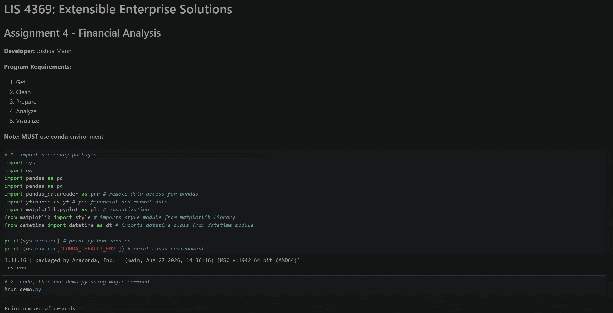

# LIS 4369: Extensible Enterprise Solutions

## Joshua Mann

### Assignment 4 Requirements:
1. Backward-engineer (using Python) the A4 video
2. Utilize cleaned file from past assignment for analysis
3. Ensure Python test environment is used for programming packages
4. 3 skillsets with screenshots and file locations

### README.md file should include the following items:

* Gif of A4 program
* Link to a4.ipynb file
* 3 skillsets with links to functions, home directory, and images/gifs of running programs

### Assignment Screenshots/Gifs:

#### *A4 Reverse-Engineered Program:* [a4.ipynb](a4.ipynb)

### Assignment Skillsets: [Skillsets Home Directory](https://github.com/jm23p/lis4369/tree/main/skillsets)

#### *Skillset 10: Using Dictionaries:* 

#### *Skillset 11: Pseudo-Random Number Generator:* 

#### *Skillset 12: Temperature Conversion Program:* 
