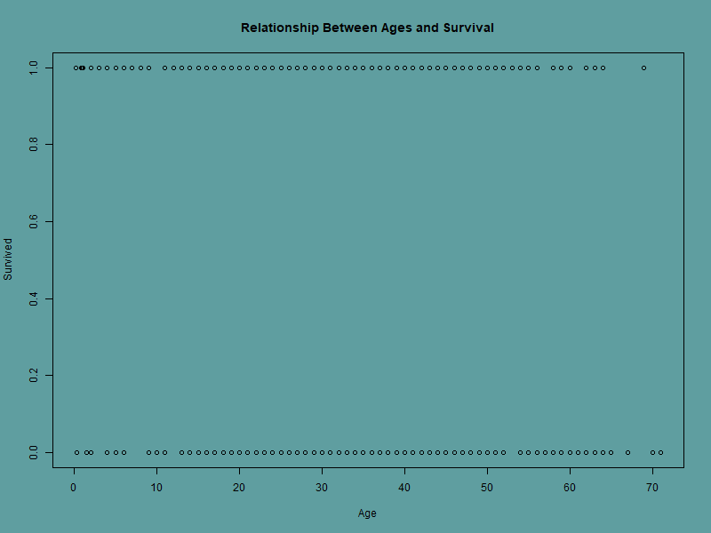
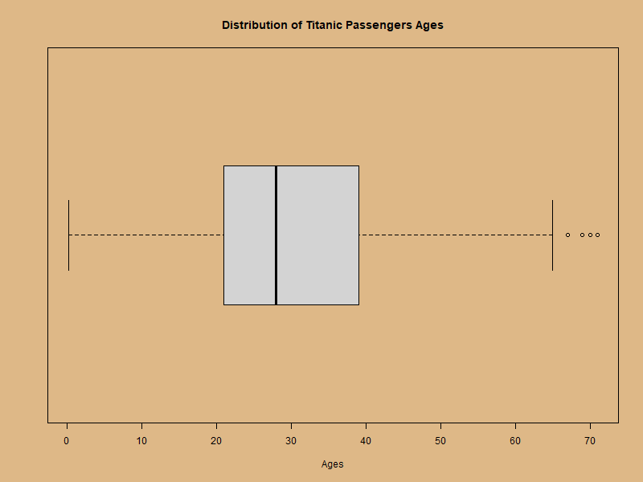

# LIS 4369: Extensible Enterprise Solutions

## Joshua Mann

### Assignment 5 Requirements:
1. Complete R Setup and Tutorial
2. Code and run R Tutorial program
3. Code and run LIS4369 A5 R program
4. Include at least two 4-panel RStudio screenshots
5. Include links to both learn_to_use_r.R and lis4369_a5.R
6. Complete and provide terminals of completed skillsets

### README.md file should include the following items:

* Screenshots of .R files and plots
* Link to learn_to_use_r.R and lis4369_a5.R files
* 3 skillsets with links to functions, home directory, and images/gifs of running programs

### Assignment Screenshots/Gifs:

#### *learn_to_use_r.R File:* [.R File](learn_to_use_r.R)

**Example Plots for Learn_to_use_r.R:**

#### *lis4369_a5.R File:* [.R File](lis4369_a5.R)

**Example Plots for lis4369_a5.R:**

### Assignment Skillsets: 

#### *Skillset 13: Sphere Volume Calculator* [SS13 Directory](https://github.com/jm23p/lis4369/tree/main/skillsets/ss13_sphere_volume_calculator)

#### *Skillset 14: Calculator With Error Handling* [SS14 Directory](https://github.com/jm23p/lis4369/tree/main/skillsets/ss14_calculator_with_error_handling)

#### *Skillset 15: File Write/Read* [SS15 Directory](https://github.com/jm23p/lis4369/tree/main/skillsets/ss15_file_write_read)
